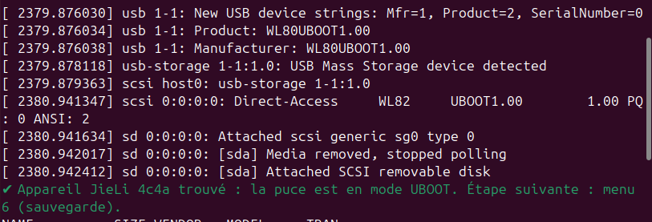
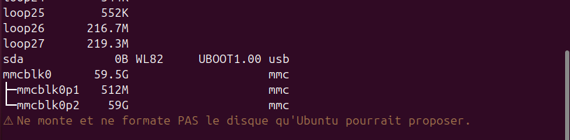
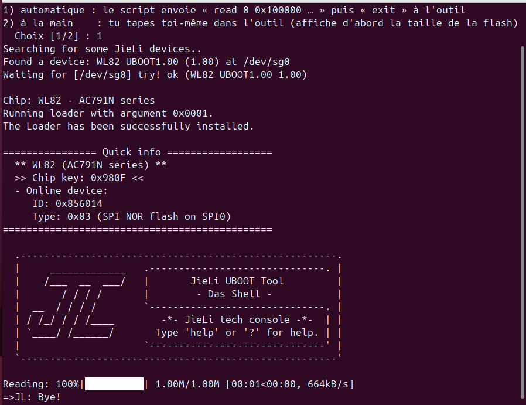
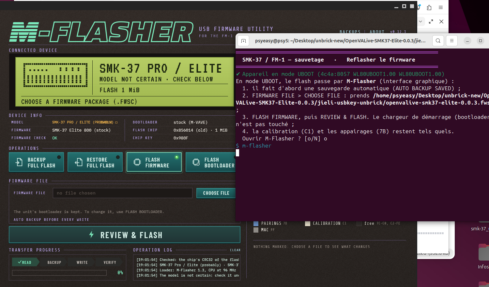

# jieli-usbkey-unbrick

**Bring back a JieLi-based device that no longer boots — without opening it.**
First made for the M-VAVE **SMK-37** and **FM-1**.

> 🇫🇷 [Lire en français](README.fr.md) · 🌐 **The illustrated page: <https://tom-rfid.github.io/jieli-usbkey-unbrick/>**

A firmware that crashes at start-up leaves the device invisible over USB: no MIDI port, the maker's tools cannot see
it, buttons at power-on do nothing. Inside, the JieLi chip still holds a **factory USB loader** in its ROM ("UBOOT").
This repository opens that loader from a Raspberry Pi, through the device's own USB cable, then backs up and rewrites
the firmware with [M-Flasher](https://github.com/jvitkauskas/m-flasher).

| | |
|---|---|
| ✅ **Tested** | M-VAVE SMK-37 Elite, Raspberry Pi 5 — key, 1 MB backup, firmware written, device back (November 2026) |
| ✅ **Tested** | M-VAVE FM-1 (latest board, no logo under the screen), Raspberry Pi 5 — key, 1 MB backup (November 2026) |
| 🔶 **Should work, not tested yet** | SMK-37 Pro, Raspberry Pi 4 |
| 🧪 **Prepared, not tested** | the key from a Raspberry Pi Pico (RP2040): [`rp2040/`](rp2040/README.md) |

## How it works

The chip's ROM looks, as it powers up, for a special pattern on its USB lines: the **USB key**. If it sees it, it
starts its USB loader instead of the firmware. The key is the 16-bit number **`0x16EF`**, sent most significant bit
first, with **D+ as the clock** and **D− as the data**: the chip reads D− on each **rising edge of D+**.

```
  0x16EF  =  0001 0110 1110 1111   (most significant bit first)

  D+ (clock)  ‾‾|__|‾‾|__|‾‾|__|‾‾|__|‾‾|__|‾‾|__|‾‾|__|‾‾|__|‾‾ …   about 50 kHz
                   ↑     ↑     ↑     ↑     ↑     ↑     ↑     ↑        the chip reads D- on each rising edge
  D- (data)        0     0     0     1     0     1     1     0  …     set while D+ is low, one bit per clock
```

1. The device is **off**; the Raspberry Pi starts sending the key over and over (6 seconds).
2. You **switch the device on**: its ROM catches the key and answers by pulling both lines low for 1–2 ms.
3. The script **lets go of the lines** (they become inputs): the chip starts its USB loader, and the Raspberry Pi —
   the USB host at the other end of the same cable — sees a new device: **`4c4a:8057` `WL80UBOOT1.00`**.
4. **M-Flasher** reads the whole flash (a backup first, always), then writes the firmware (`.fwsc`) without touching
   the **bootloader**, the **key calibration** or the **Bluetooth pairings**.

Linux does not give microsecond timing, but it does not need to: the chip follows the clock, not a fixed speed.

## The wiring

You need a Raspberry Pi 4 or 5, a USB-A → USB-C **data** cable, three wires (two 100 Ω resistors if you have them)
and a multimeter for one check. The USB-A end **stays in the Raspberry Pi**: after the key, the Pi is the host that
sees the chip.

```
   USB-A end (Raspberry Pi's USB port)            USB-C end (the device)
     red   5V  ════════════════════════════════════ red        ← NEVER to the GPIO (5 V kills it)
     black GND ════════════════╦═══════════════════ black
                               ╚════════════════════════════→ pin 9  (GND)
     green D+  ════════════════╦═══════════════════ green
                               ╚═══[ 100 Ω ]════════════════→ pin 11 (GPIO17)  ★ D+ clock
     white D-  ════════════════╦═══════════════════ white
                               ╚═══[ 100 Ω ]════════════════→ pin 13 (GPIO27)  ★ D- data
```

Open the cable's jacket in the middle and add the three wires **without cutting** (solder, then insulate every joint),
or cut it and join the colours back with 3-way Wago connectors, the third entry going to the Pi.

```
   Raspberry Pi 4 / 5 — 40-pin header, top view (header at the top edge, pin 1 on the left)
   ┌──────────────────────────────────────────────────────────── top edge of the board
   │    2    4    6    8   10   12   14   16 …
   │   [5V] [5V] [GND][TX] [RX] [G18][GND][G23] …
   │   [3V3][G2] [G3] [G4] [GND][G17][G27][G22] …
   │    1    3    5    7    9   11   13   15 …
   │                        ▲    ▲    ▲
   │                      black D+   D-        (inner row, 5th, 6th and 7th holes from the left)
```

**Check before cutting**, multimeter in beep mode, cable unplugged — USB-A plug facing you, plastic tongue down:
`[1] 5 V red · [2] D− white · [3] D+ green · [4] GND black`. Contact 3 ↔ green, 2 ↔ white, 4 ↔ black must beep; no
two wires may beep together. Some cheap cables use other colours: trust the beep, not the colour.

## Use

```bash
chmod +x rescue-en.sh
./rescue-en.sh            # French: ./rescue-fr.sh
```

| Menu | What |
|---|---|
| 1 | the steps, in order (start here) |
| 2 | the wiring on screen, Pi 4 / Pi 5 |
| 3 | install everything (Python, GPIO, jl-uboot-tool, M-Flasher, MIDI tools) |
| 4 | send the key: switch the device **off**, Enter, then **on** within 6 s |
| 5 | is the device seen? (`lsusb`, `dmesg`: look for `4c4a`) |
| 6 | **back up the whole flash** — before anything is written |
| 7 | log and diagnostics, saved to a text file |
| 8 | key settings: swap D+/D−, slower, longer, **key from a Pico** |
| 9 | choose the firmware: the `.fwsc` next to the script, a custom one (path or URL), or an official one |
| 10 | flash: M-Flasher in UBOOT mode, or over MIDI if the device still runs |

**The order matters**: the unit **off**, Enter at menu 4, **then** switch it on. Switched on before, it boots normally
as MIDI (the script recognises it and says so: `3654:7756` SMK37 Open, `1209:0001` OpenVALive FM-1…) and the key does
nothing; the backup (menu 6) only works in UBOOT mode (`4c4a`). The FM-1 and the SMK-37 share the same loader, `4c4a:8057`.

Nothing seen at step 5? Switch on a bit earlier or later, then try menu 8 (slower clock, or D+ and D− swapped).

## What it looks like

The loader is seen (menu 4, then 5): `WL80UBOOT1.00`, as a removable disk `WL82 UBOOT1.00`.



It shows as an empty disk (0 B): never mount or format it.



The backup (menu 6): the WL82 chip (AC791N series), its SPI NOR flash read whole, 1 MB in two seconds.



Flashing (menu 10): in UBOOT mode the script hands the chosen firmware to M-Flasher's command line
(`m-flasher firmware file.fwsc --board smk37 --restart`, you type `yes`), or opens its window:



## Good to know

- **Keep your backup** (on a USB stick too). Never restore another unit's backup onto yours: the key calibration is
  per unit.
- The key works through the cable: **no need to open the device**. On these boards the flash sits inside the JieLi
  package, so there is no flash chip to short anyway.
- The firmware files (`.fwsc`) are model-specific: an SMK-37 Elite refuses a Pro package and the other way round.

## Thanks

- [kagaimiq / jielie](https://kagaimiq.github.io/jielie/isp/usb/usb-key.html) — the USB key, documented.
- [jvitkauskas / m-flasher](https://github.com/jvitkauskas/m-flasher) — the flasher for the FM-1 and the SMK-37.
- [kagaimiq / jl-uboot-tool](https://github.com/kagaimiq/jl-uboot-tool) — the UBOOT protocol.

Made while bringing an SMK-37 back from a bad firmware, for [OpenVALive](https://github.com/Tom-Rfid/OpenVALive_SMK-37).
Not affiliated with M-VAVE or JieLi. Use at your own risk. Licence: MIT.
